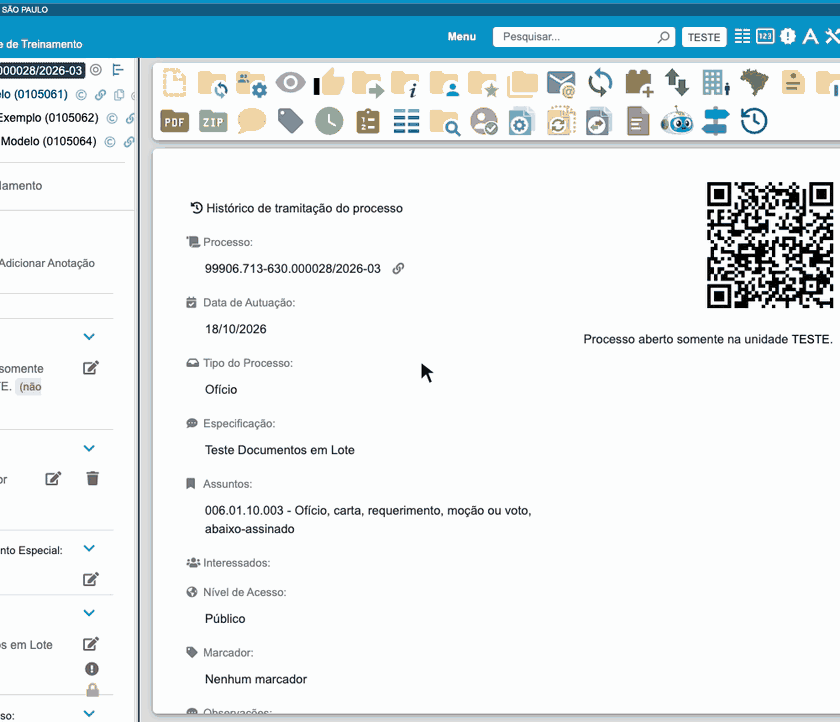

#  |  SEI Pro 

##  Documentos em Lote

Cria **vários documentos de uma vez** a partir de um **modelo** e de uma **planilha**. É a "mala direta" do SEI: um ofício para cada município, uma notificação para cada empresa, uma portaria para cada servidor — cada um com os dados da sua linha da planilha.

> 

### Antes de começar: prepare o modelo e a planilha

**1. O documento modelo.** No mesmo processo em que os documentos serão criados, escreva um documento com o texto comum e, no lugar das informações que mudam, coloque **campos entre dois pares de cerquilhas**:

> Ao Senhor **##nome##**, Prefeito de **##municipio##**, ...

Também é possível usar como modelo um **Texto Padrão** da unidade.

**Documentos em outros processos.** O SEI copia o texto do modelo **exatamente como está**, inclusive um cabeçalho como "Processo nº ... / Interessado: ...". Se os documentos forem criados em **outros processos** (destino "processo novo por linha" ou "processo indicado em uma coluna"), esse cabeçalho sairá com o número e o interessado do processo do modelo. Nesse caso, **não deixe número de processo nem interessado fixos no modelo**: troque-os por campos (`##processo##`, `##interessado##`) e traga os valores da planilha. A prévia avisa quando o texto do modelo cita o número do processo dele e algum documento vai para outro processo. O cabeçalho com o código de barras não conta: esse o SEI refaz em cada documento, com o número e o processo de destino.

**2. A planilha.** No Excel, LibreOffice Calc ou Google Planilhas, monte uma tabela em que:

* a **primeira linha** traz os nomes dos campos, **exatamente iguais** aos do modelo, sem as cerquilhas (`nome`, `municipio`...);
* **cada linha seguinte** vira um documento.

| nome | municipio |
| ---- | --------- |
| Maria Souza | Campinas |
| João Lima | Santos |

Salve no formato **CSV** (*Arquivo › Salvar como › CSV*).

### Como usar

Clique em **Iniciar Documentos em Lote**, na barra de botões do processo. A janela guia você por etapas, mostradas no topo; o botão **Avançar** só é liberado quando a etapa está completa, e o **Voltar** permite corrigir a anterior. Para desistir, feche a janela no **X** (ou com **Esc**).

1. **Modelo:** escolha, na árvore do processo, o documento modelo (ou um Texto Padrão). Os campos `##...##` encontrados são listados;
2. **Planilha:** escolha o arquivo CSV. A ferramenta mostra as colunas e a quantidade de linhas lidas;
3. **Cruzamento:** veja qual coluna preenche cada campo do modelo (as de mesmo nome já vêm escolhidas) e defina:
   * **Coluna do nome na árvore** — qual coluna dará nome a cada documento (obrigatório);
   * **Descrição do documento** (opcional) — texto do campo *Descrição* de cada documento. Use `##coluna##` para trazer o valor da planilha, sozinho ou junto com texto: `Termo de sigilo - ##nome## (##unidade##)`. Em branco, o campo fica vazio;
   * **Onde criar os documentos** — o [processo de destino](#processo-de-destino);
   * **Nível de acesso e hipótese legal** (opcional) — veja [abaixo](#nível-de-acesso-e-hipótese-legal);
   * **Pausa entre um documento e outro**, em milissegundos;
4. **Verificação** (só quando o destino é "o processo indicado em uma coluna"): confere cada processo antes de gravar — veja [Verificação antes de gravar](#verificação-antes-de-gravar);
5. **Prévia:** mostra, linha a linha, como ficará cada documento (destino, nome, descrição e texto) e aponta os problemas. Clique em **Iniciar** para criar;
6. **Execução e resultado:** acompanhe o progresso. Ao final aparece a tabela com cada linha da planilha, o documento gerado, o número SEI e o link, que pode ser **copiada** ou **baixada em CSV**. Quando algum documento é criado no processo aberto na tela, a árvore desse processo é atualizada ao final.

### Processo de destino

Na etapa **Cruzamento** você escolhe onde cada documento será criado:

* **No processo aberto na tela** — todos os documentos vão para o processo em que você abriu a ferramenta;
* **Em um processo novo por linha** — a ferramenta abre um processo para cada linha e cria o documento dentro dele;
* **No processo indicado em uma coluna** — a planilha traz uma coluna com o número do processo (por exemplo `50300.012345/2026-11`) e cada documento entra no processo da sua linha. Útil para mandar um documento diferente a vários processos já existentes. O mesmo processo pode aparecer em várias linhas.

### Verificação antes de gravar

No destino "processo indicado em uma coluna", cada processo é consultado **uma vez** antes de qualquer documento ser criado, para você não descobrir o problema só no meio do lote. A tabela mostra a situação de cada um:

* **OK** — pode gravar;
* **Não encontrado ou sem acesso** — o número não existe ou a sua unidade não o enxerga;
* **Sigiloso** — o processo é sigiloso e não recebe documentos por esta ferramenta;
* **Não aberto na unidade** — o processo não está aberto na unidade em que você está;
* **Tipo indisponível** — o tipo de documento do modelo não pode ser criado naquele processo;
* **Erro de rede** — a consulta falhou; tente de novo.

Em cada linha há **Abrir em nova aba** (para ver o processo, receber ou reabrir) e **Verificar de novo**; no topo, **Verificar de novo os com problema** consulta outra vez todos os processos que não deram OK (os que deram OK são conferidos de novo na hora de gravar cada documento). Depois de resolver um problema no SEI, verifique de novo.

Você não precisa resolver tudo: **Gravar** cria os documentos só das linhas válidas, e as demais ficam de fora. Mais tarde, quando elas estiverem corrigidas, o botão **Gravar as que ficaram de fora** cria o que faltou.

### Nível de acesso e hipótese legal

Duas colunas opcionais da planilha controlam o nível de acesso de **cada documento**:

* **Coluna do nível de acesso** — aceita `Público` (ou `0`) e `Restrito` (ou `1`). Célula vazia vale como público;
* **Coluna da hipótese legal** — obrigatória nas linhas restritas. Escreva o nome da hipótese como aparece no SEI.

Sem coluna de nível, todos os documentos saem públicos. Um nível que não seja reconhecido, ou uma linha restrita sem hipótese, é apontado como erro da linha, para que um documento que deveria ser restrito não seja criado como público.

### Prévia

Antes de criar, a prévia permite conferir uma linha de cada vez, com o texto do documento já preenchido. Os campos `##...##` sem coluna correspondente aparecem **marcados**, porque ficariam como estão no texto. Linhas com erro (processo inválido, nome vazio, nível inválido) são listadas e ficam de fora.

Se o texto do modelo cita o número do processo em que o modelo está e algum documento vai para **outro processo**, a prévia mostra um aviso: esses documentos manterão aquele número (e provavelmente o interessado do processo original). O aviso não impede de iniciar, mas o recomendado é corrigir o modelo antes (veja [Documentos em outros processos](#antes-de-começar-prepare-o-modelo-e-a-planilha)).

### Durante a execução

Uma linha que falha **não interrompe o lote**: o erro é registrado e a ferramenta segue para a próxima. As linhas já criadas continuam no SEI. Há os botões **Pausar**, **Continuar** e **Minimizar** (que recolhe a janela numa pastilha de progresso no canto da tela). Não mude de página nesta aba enquanto o lote roda: mudar de página interrompe o lote, que fica guardado e pode ser retomado.

### Retomar de onde parou

O andamento do lote é guardado **só neste navegador**. Se a janela for fechada ou a página recarregada no meio, ao abrir a ferramenta de novo aparecem **Continuar de onde parou** e **Descartar**. Quando o lote termina **sem nada pendente**, o registro é apagado ao fechar o resultado (ou ao clicar em **Concluir**). Se sobrar alguma linha com erro, incerta, de fora ou ainda não enviada, o lote fica guardado por **até 7 dias após o último uso**, a menos que você clique em **Concluir** ou **Descartar** antes. Se o lote parecer estar rodando em outra aba, a ferramenta avisa, para não gerar documentos em duplicidade.

### Repetir só as que falharam

No resultado, **Repetir só as que falharam** cria novamente apenas as linhas que, com certeza, não foram criadas. As linhas **incertas** — aquelas em que a rede ou o SEI falhou no meio da criação, sem dar para saber se o documento nasceu — **não são repetidas automaticamente**, para não duplicar. **Confira no SEI** se o documento existe antes de repeti-las; se mesmo assim quiser, a ferramenta pede uma confirmação. Quando o **processo novo** de uma linha foi criado mas o número dele não pôde ser lido, o resultado mostra o link **Abrir o processo criado** (o mesmo link vai na coluna `processo_destino` do CSV): confira esse processo antes de repetir, porque repetir a linha cria outro processo.

### Resultado

A tabela final traz, além das colunas da sua planilha, estas quatro:

* `processo_destino` — o processo em que o documento foi criado;
* `nome_documento_gerado` — o nome do documento na árvore;
* `numero_sei_gerado` — o número SEI do documento;
* `link_documento_gerado` — o link do documento.

Ela pode ser copiada ou baixada em CSV. O botão **Gerar links permanentes destes documentos** abre a ferramenta de links permanentes já preenchida com os números criados.

> A ferramenta foi construída a partir do código-fonte do **PluriDocs SEI!**, gentilmente cedido por tcgontijo.

### Como ativar

A função vem **ligada** de fábrica. Ela fica nas [Configurações do SEI Pro](../pages/DESATIVARFUNCOES.md), aba **Geral**, seção **Árvore e Visualização de Documentos**, opção **Documentos em Lote**.

### Bom saber

* **Os nomes dos campos precisam ser escritos exatamente da mesma forma** no modelo e na planilha. Evite acentos e espaços nos nomes (`municipio`, `data_oficio`). Um campo sem correspondência fica sem preenchimento.
* A codificação do CSV (UTF-8 ou a do Excel antigo) é detectada automaticamente, para os acentos saírem corretos.
* Os acentos são retirados do **nome do documento na árvore** (*José* vira *Jose*), porque nem todos os caracteres são aceitos pelo SEI nesse campo. Símbolos como º, ª e ° continuam no nome (*Ofício nº 1ª* vira *Oficio nº 1ª*). O mesmo vale para o **Número**, nos tipos de documento em que ele é informado. O texto do documento mantém os acentos. No SEI 3, a ferramenta avisa antes de continuar.
* Na **descrição dos documentos** e na **especificação dos novos processos**, os caracteres que o SEI não aceita, típicos de texto colado do Word ou do Excel, são trocados pelo equivalente simples: o travessão (—) vira hífen (-) e as aspas curvas (“ ”) viram aspas retas ("). Os acentos são mantidos. A descrição vai até 250 caracteres, o limite do SEI.
* Os documentos são criados **sem assinatura**. Para assinar todos de uma vez, use [Ações em Lote](../pages/ACOESEMLOTE.md).
* Se uma linha falhar, o motivo aparece no resultado e o lote continua. No destino **Em um processo novo por linha**, se o processo da linha chegou a ser aberto sem o documento, a ferramenta mostra o link dele: confira-o antes de repetir.
* Cada lote aceita até **2000 linhas** e até **2 MB** de dados (o andamento do lote é guardado no navegador, num espaço dividido com as outras ferramentas do SEI Pro). Planilhas com células muito longas podem passar desse limite mesmo com menos linhas: a ferramenta avisa ao carregar o arquivo ou na Prévia, sem enviar nada ao SEI. Nos dois casos, divida a planilha em arquivos menores.
* Faça um teste com uma planilha de duas ou três linhas antes de gerar um lote grande.

## Próximo item

> [Comparador de Documentos](../pages/COMPARARDOCUMENTOS.md)
