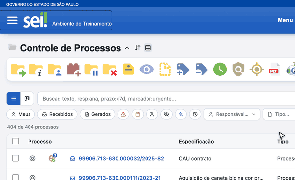

#  |  SEI Pro 

##  Menu Suspenso

O menu lateral do SEI ocupa uma faixa fixa da tela, mesmo quando você não está usando. Com o **Menu Suspenso**, ele fica **escondido e aparece por cima do conteúdo** só quando você precisa — as tabelas e documentos ganham a largura inteira da janela.

> 

### Como usar

1. Clique no ícone de menu (☰), ao lado do logotipo do SEI, para abrir o menu — ele aparece por cima da tela, sem empurrar o conteúdo;
2. Escolha a opção desejada;
3. Para fechar, clique de novo no ícone, **fora do menu**, ou aperte **Esc**.

A tela sempre abre com o menu fechado, e o SEI Pro não guarda se você o deixou aberto: ao trocar de tela, ele volta a ficar escondido.

### Como ativar

A função vem **desligada** de fábrica. Para ligar, abra as [Configurações do SEI Pro](../pages/DESATIVARFUNCOES.md), aba **Geral**, seção **Controle de Processos**, e marque **Menu Suspenso**. Clique em **Salvar**. Vale também para as telas já abertas, sem recarregar o SEI.

### Bom saber

* No SEI 4 e 5, o ícone nativo de exibir/ocultar menu é trocado pelo ☰, para não haver dois botões fazendo a mesma coisa.
* Em janelas estreitas (menos de 768 px), o SEI usa o menu de celular dele e o Menu Suspenso não interfere.
* Veja também [Ordenar itens do menu](../pages/ORDERNARMENU.md), para deixar as opções que você mais usa no topo.

## Próximo item

> [Ordenar itens do menu](../pages/ORDERNARMENU.md)
